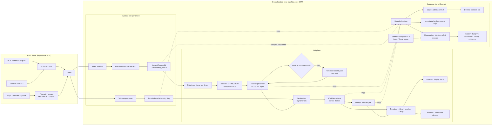

# Architecture: Real-Time Multi-Drone Danger Detection with AR at a Ground Station

Written 11 November 2026. Design document, nothing implemented. Companion to `Project Context.md` (decisions, data plan, dataset roles, Sauron review, work order).

RTMS means real-time monitoring system (confirmed 11 November 2026).

**Design goal in one line:** the shortest possible path from a photon hitting a drone camera to a labelled, positioned object on the operator's screen, while every claim stays traceable through Sauron.

---

## 1. The one idea that drives the whole design: two planes

Everything splits into a **hot plane** and an **evidence plane**.

| Plane | Job | Rule |
|---|---|---|
| **Hot plane** | Video in, detections, tracks, ground positions, alerts, pixels on the operator's screen. | Never waits on disk, on the network to another service, on a language model, or on the evidence plane. Every stage holds at most one frame per drone. If it falls behind it drops old frames, never queues them. |
| **Evidence plane** | Sauron. Original telemetry bytes, exact times, immutable keyframes, observation records, situation records, alerts with evidence links, corrections, history, authorisation. | Receives copies from the hot plane through a bounded outbox. If it lags, the lag is shown, the hot plane keeps running, and nothing is silently lost once accepted. |

This is the same split Sauron's own I3 document already describes ("the first path provides responsive viewing ... the second path preserves explicitly selected evidence"). We are making it the backbone of the whole product instead of a pilot.

---

## 2. Component map

Solid arrows are the hot plane. Dotted arrows are copies into the evidence plane. Nothing on the hot plane depends on anything in the evidence plane.

---

## 3. The latency budget

The number that matters is **glass to glass**: from the moment light hits the camera to the moment the operator sees the labelled object. Most of it is spent before the ground station sees anything, in the drone's encoder and the radio link, which we do not control. Our job is to keep the ground-station share small and measured.

| Stage | Where | Rough cost | Note |
|---|---|---|---|
| Camera exposure and encode | Drone | 30 to 60 ms | Fixed by payload. Low-latency encoder profile where the payload allows. |
| Radio link | Air | 100 to 250 ms | Fixed by the link. The biggest single term. |
| Receive and hardware decode | GS | 5 to 15 ms | NVDEC, output stays in GPU memory. |
| Newest-frame slot wait | GS | 0 to one frame | Only if the detector is busy. Old frame is replaced, never queued. |
| Detector, batched, FP16 | GS | 8 to 25 ms | Estimate for an S or M model at 960 to 1280 px on an RTX-class GPU with a batch of 4 to 6 drones. Must be measured. |
| Tracker and ROI second pass | GS | 1 to 10 ms | Second pass only for selected tracks, batched. |
| Geolocation and fusion | GS | under 1 ms | Pure arithmetic. |
| Rules engine | GS | under 1 ms | Ordinary code over a small table. |
| Render to local display | GS | one display frame, about 16 ms | Renders at display rate regardless of detection rate. |
| **Ground-station total** | | **about 30 to 70 ms** | Target: under 100 ms at the 99th percentile. |
| **Glass to glass** | | **about 200 to 400 ms** | Dominated by the link. |

Every figure marked as an estimate must be replaced by a measurement on the real machine with per-stage timestamps. The edge report notes that the only published combined accuracy-plus-speed measurement on edge hardware is a single Raspberry Pi experiment, so we plan on measuring, not quoting.

For the asynchronous parts: scene descriptions from the vision-language model take 2 to 4 seconds in Sauron's current runs. They never sit in the hot plane. Sauron's engine target of 50 ms for live admission is for the evidence plane and is separate from the display path.

---

## 4. Hot plane, stage by stage

### 4.1 Drone side

Kept deliberately simple in version one so that the undecided drone choice does not block anything.

- Two video streams, RGB and thermal, H.265, low-latency encoder settings, sent as RTP or through the vendor SDK.
- Telemetry at 10 to 50 Hz: position, height, attitude, gimbal angles, camera zoom, with the drone's own clock. MAVLink or DJI SDK depending on the platform.
- No on-board inference in version one. A nano convolutional detector on the drone (YOLOX or PP-YOLOE class, not a transformer) is a later option if radio bandwidth forces it.

### 4.2 Ingress

One ingress unit per drone, all on the ground station.

- **Video receiver** takes RTP, RTSP or the SDK stream. Reconnects on loss. Assigns each frame a receive timestamp on the ground station's monotonic clock and keeps the stream's own presentation timestamp.
- **Hardware decode** on NVDEC through GStreamer or DeepStream. The decoded frame stays in GPU memory. No copy to CPU RAM. One ground-station GPU decodes many 1080p streams.
- **Newest-frame slot** is a one-element holder per drone in GPU memory. The detector takes whatever is there. If a new frame arrives before the old one is taken, the old one is replaced and a counter increments. This is the single most important rule for low latency: no queue ever grows.
- **Telemetry receiver** parses the stream and writes into a **time-indexed ring buffer** per drone, so that for any frame timestamp we can interpolate position, attitude, gimbal and zoom. The same bytes are copied, unchanged, to Sauron's admission path.

### 4.3 Detector

- **Model:** D-FINE or DEIM v1 (Apache-2.0), trained in the stages described in `Project Context.md` section 4b. Size S for the first build, M as the teacher and as an option if the GPU allows.
- **Runtime:** TensorRT, FP16, fixed input shape, engine prebuilt and warmed at startup. No INT8 for the transformer; it loses accuracy and gains almost nothing in speed.
- **Input size:** 960 to 1280 px on the full frame. Resolution is the first lever for small targets.
- **Batching:** one inference call per tick with one frame from each drone. Batching 4 to 6 frames costs much less than 4 to 6 separate calls.
- **Thermal:** a second detector of the same family trained on thermal, run in the same batch when thermal is on. Fusion is at decision level: boxes from both are merged per drone with a weighted rule. By day, thermal can be switched off to save budget; at night it carries most of the load.
- **No NMS needed** for the main pass. DETR-family models predict a set directly. Merging the ROI second pass into the main pass uses cluster-DIoU NMS on GPU.

### 4.4 Tracker

- OC-SORT or ByteTrack style, one instance per drone, no appearance network. Tuned for tiny boxes: 2x box expansion and centre-distance cost instead of plain overlap, as recommended in the edge report.
- Camera motion compensation from the telemetry ring (the gimbal angle change between frames) instead of an image-based estimate. This is cheaper and more reliable because we know how the camera moved.
- When the detector runs slower than the video, the tracker predicts positions between detections and every predicted box carries its age. The display shows predicted boxes differently from observed ones.

### 4.5 Zoom on demand, not tiling always

Full tiling of every frame costs 4 to 7 times a single pass. Instead:

- A track that is small, low confidence, or newly born triggers a **region-of-interest crop** at native resolution.
- Crops from all drones are batched into a second TensorRT profile and run once per tick.
- Results merge back into the tracker. This is the GL-YOMO pattern from the edge report, which lifted recall from 0.56 to 0.83 on tiny aircraft at real-time rates.
- A CPU frame-difference motion proposer can be added for stationary or slow-panning hovers to catch what the detector misses.

### 4.6 Geolocation

For each track, at the frame's timestamp:

1. Interpolate drone position, attitude, gimbal angles and zoom from the telemetry ring.
2. Build the camera pose from those plus the camera's calibration (intrinsics, mounting offset).
3. Cast a ray through the box's bottom-centre pixel.
4. Intersect with the terrain model (a digital elevation model, with flat-ground fallback).
5. Output latitude, longitude, height, and an uncertainty ellipse derived from telemetry uncertainty and the pixel size at that range.

This is arithmetic, microseconds per track. It requires the Sauron additions listed in `Project Context.md` section 6b: an attitude and gimbal family, and a calibration record per camera. Without telemetry for a frame, the track is still shown on video and marked "position unavailable".

### 4.7 World track table and cross-drone fusion

- A single in-memory table of world objects. Each world object holds contributing drone tracks, a fused position, class votes, velocity, first and last seen, and a confidence.
- Association across drones is gated by position uncertainty overlap, time, and class agreement. No appearance re-identification in version one.
- Following Sauron's entity contract, a cross-drone match is an **association hypothesis**, kept separate from each drone's own track identity, and reversible.

### 4.8 Danger rules engine

- Ordinary deterministic code over the world track table. Rules are data, versioned, written with domain experts.
- Rule shapes: class in zone, distance between classes, convoy count, approach speed toward an asset, object where nothing should be, new object appearing, object lost near a boundary.
- Each alert carries the rule version, the contributing tracks, the frames and the telemetry it used. It is published to the renderer immediately and to Sauron as an evidence-linked record.
- No language model here. The vision-language description (Sauron's Luna and Terra) runs asynchronously and attaches text to the situation record seconds later for the operator to read, never to decide an alert.

### 4.9 Renderer and operator display

- **Local display** on the ground-station machine is the primary AR view: the live video of each drone with boxes, labels, track ages and alert flags, plus the shared map with world objects, drone positions, uncertainty ellipses and zones. Rendering at display rate, independent of detection rate. This is the lowest-latency option because there is no network hop.
- **WebRTC** for remote or secondary viewers, through a relay such as MediaMTX. Overlays are composited into the stream at the ground station, so boxes and frames can never drift apart (Sauron's I3 document makes this same point). Expect roughly 100 to 300 ms extra.
- The Sauron Blueprint dashboard remains the place for history, evidence inspection and corrections. It is not the live AR surface.

---

## 5. Evidence plane: how Sauron is used

| What the hot plane produces | Where it goes in Sauron | How |
|---|---|---|
| Raw telemetry bytes | G2 admission, then G3 derived contexts | Existing MAVLink and DJI paths, plus the new attitude and gimbal family |
| Sampled keyframes and alert clips | Immutable media store with hashes | Sampling policy declared: for example one keyframe per drone per second plus a short clip around every alert |
| Detections and tracks | `sauron.intelligence.objects.v1` observation records | Same contract Sauron already has for its YOLO path, with our model's identity and configuration hash |
| World objects and fused positions | Situation records (I4.2 contract) extended with geolocation fields | New additive schema version |
| Alerts | New alert record linked to rule version, tracks, frames and telemetry | New contract |
| Scene descriptions | Existing Luna and Terra flow, asynchronous | Unchanged |
| Operator actions on alerts | Explanation and task records | Feeds step 9 of the work order, learning from operators |

The outbox between the planes is a bounded ring per record type. When Sauron accepts a record it is durable with its receipt. When the outbox is full, the hot plane marks the gap, keeps running, and the gap is visible on the dashboard. This matches Sauron's rule that a full queue must produce explicit lag or a declared gap, never silent loss.

Authorisation for the operator display uses Sauron's existing principal and gateway. The hot plane does not invent a second identity system.

---

## 6. Clocks

Latency only means something if clocks agree.

- The ground station runs on one monotonic clock. All hot-plane stage timestamps use it.
- Each drone's telemetry keeps its own clock and its own relation to UTC, as Sauron requires. The ingress records the mapping between drone time and ground-station time from link round trips, with uncertainty.
- Video frames carry the stream's presentation timestamp and the ground-station receive time. Frame to telemetry matching uses the mapped drone time, never receive time alone.
- Every object on screen carries an age: how old the newest observation behind it is. Operators see staleness instead of guessing.

---

## 7. Scaling and degradation

- **More drones** means more decoders (cheap), a bigger inference batch (the main cost), and more trackers (cheap). One RTX-class GPU should handle about 4 to 6 drones at 1080p with detection on most frames. This is a planning estimate to be measured.
- **When the GPU saturates**, the policy is to lower the detection rate per drone and let the trackers fill in, with priority to drones that have active alerts or tracks in the ROI pass. Queues never grow.
- **When a link drops**, that drone's tracks go stale with visible age, its world objects keep their last position marked stale, and nothing else slows down.
- **When telemetry is missing** for a drone, boxes still appear on its video and the map shows "position unavailable" for them.
- **When Sauron lags**, the live view is unaffected and the dashboard shows the evidence backlog.

---

## 8. Hardware and software choices

| Item | Choice | Reason |
|---|---|---|
| Ground-station machine | x86 workstation with one NVIDIA RTX-class GPU and NVMe. Jetson AGX Orin if a ruggedised box is required. | NVDEC for decode, TensorRT FP16 for the transformer, enough memory for Sauron beside it. |
| Video pipeline | GStreamer or DeepStream with NVDEC, zero-copy to CUDA | Decode once, keep frames on the GPU. |
| Detector | D-FINE or DEIM v1, TensorRT FP16 | Apache-2.0, best small-object accuracy per compute, no NMS. |
| Tracker | OC-SORT or ByteTrack, tiny-box tuning, telemetry-based motion compensation | No appearance network, sub-millisecond. |
| Hot-plane services | Rust, with C or C++ where DeepStream requires it | Same language as Sauron, predictable latency, no garbage-collection pauses. |
| Training | Python | Standard tooling. Training never runs on the ground station. |
| Map and terrain | MapLibre as in Sauron; a digital elevation model served locally | Terrain is required for geolocation. Sauron's map stack already lists DEM as the next direction. |
| Remote viewing | WebRTC via MediaMTX | Sub-second to a browser; composited overlays. |
| Evidence and history | Sauron unchanged | Already built and reviewed. |

Deliberately not in version one: on-drone inference, appearance re-identification across drones, INT8 for the transformer, a language model in the decision loop, cloud processing.

---

## 9. What has to be measured, with the first milestone

Build the measurement before the features. Every hot-plane stage stamps its start and end on the shared monotonic clock, keyed by drone and frame. The first milestone is a single recorded 1080p stream through decode, detector, tracker and local display, with a report of p50, p95, p99 and maximum for each stage and for the whole ground-station path. That report, not the architecture document, decides the model size, the input resolution, and the detection rate per drone.

---

## 10. How this maps to the work order in `Project Context.md` section 7b

| Work-order step | Architecture parts it builds |
|---|---|
| 1. Scorecard | The measurement harness of section 9 plus the accuracy test set. |
| 2. Eyes on recordings | Ingress from file, detector, tracker, renderer on video, objects into Sauron. |
| 3. Geometry | Telemetry ring with attitude and gimbal, calibration record, geolocation, map markers. |
| 4. Danger rules | Rules engine and alert records. |
| 5. Ground-station view | Local renderer, then WebRTC. |
| 6. Live, one drone | Real video receiver and telemetry receiver, clock mapping, link-loss handling. |
| 7. Thermal | Second detector in the batch, decision-level fusion. |
| 8. Many drones | Batching across drones, world track table, cross-drone association, degradation policy. |
| 9. Learn from operators | Operator actions recorded in Sauron, rule tuning. |

---

## 11. Glossary for this document

- **Glass to glass**: time from light entering the camera to the result on the screen.
- **p99**: the time that 99 out of 100 frames stay under. We budget on p99, not on the average.
- **NVDEC**: the dedicated video-decoding hardware on NVIDIA GPUs.
- **TensorRT, FP16**: NVIDIA's inference runtime, using 16-bit numbers for speed without the accuracy loss of 8-bit.
- **Newest-frame slot**: a holder for exactly one frame; a new frame replaces the old one instead of waiting behind it.
- **ROI**: region of interest, a crop around a candidate object looked at in full resolution.
- **DEM**: digital elevation model, a height map of the terrain.
- **Decision-level fusion**: run two detectors and merge their boxes, rather than merging the images first.
- **Association hypothesis**: Sauron's term for "we think these two tracks are the same object", kept reversible.
